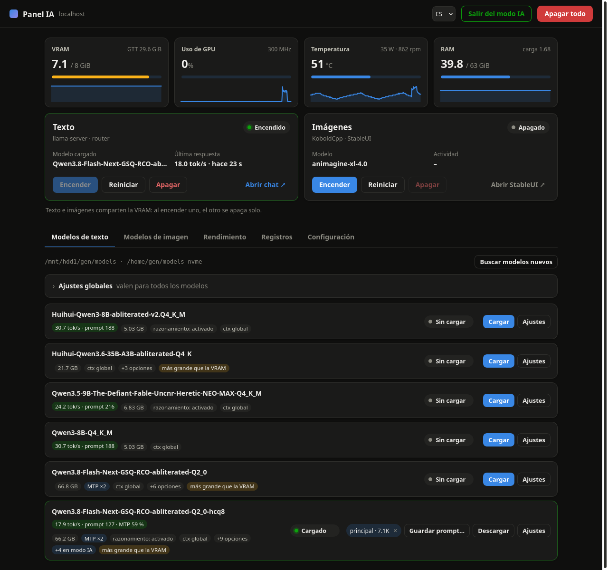
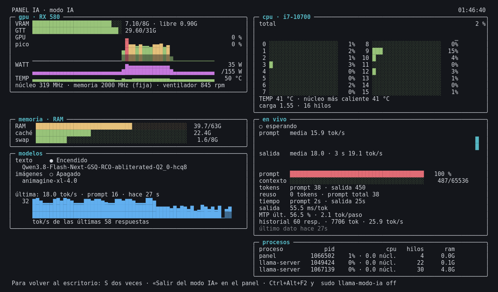

# llama-panel

[English](README.md) · **Castellano** · [](https://github.com/PrivacyPolicy404/llama-panel/actions/workflows/tests.yml)

Panel web casero para levantar y bajar modelos on demand en una GPU con poca VRAM (Vulkan):

- **Texto:** `llama-server` (llama.cpp) en modo router, puerto 8080.
- **Imágenes:** KoboldCpp con StableUI, puerto 5001.
- **Audio:** whisper.cpp (voz a texto, en la GPU al lado del modelo de texto si entra, si no en el CPU) y Piper
  (texto a voz, CPU), siempre disponibles, con rutas compatibles con OpenAI en el puerto del panel.
- **Panel:** puerto 8090. Texto e imágenes se excluyen mutuamente para compartir la VRAM.

Solo usa la biblioteca estándar de Python 3, sin dependencias ni paso de build. La interfaz está en castellano
e inglés (selector arriba a la derecha).



Está hecho y medido en una máquina concreta (AMD RX 580 de 8 GB solo con Vulkan, 64 GB de RAM, Linux con systemd);
ver [Compatibilidad](#compatibilidad) para otras.
La bitácora de rendimiento ([docs/analisis-rendimiento.md](docs/analisis-rendimiento.md)) y las notas de hardware
([docs/notas.md](docs/notas.md)) explican cada configuración con números; pueden servir en otras GPU con poca VRAM.

> **Seguridad:** el panel (8090), llama-server (8080) y KoboldCpp (5001) escuchan en todas las interfaces y **no
> tienen autenticación**: cualquiera que llegue a esos puertos puede cargar, bajar y configurar modelos. Pensado
> solo para una red local de confianza. No los expongas a internet; si hace falta acceso remoto, usá una VPN o un
> túnel SSH, o limitá los puertos con el firewall. El panel (8090) puede tener **contraseña** (Configuración,
> Acceso): el navegador inicia sesión, los programas usan tokens con nombre y desde la propia máquina (incluido un
> túnel SSH) no se pide. Con el encendido a demanda, llama-server y KoboldCpp escuchan
> solo en la máquina (18080 y 15001) y el panel atiende el 8080 y el 5001, también sin autenticación.

## Qué hace

- Monitor de VRAM, uso de GPU, temperatura/consumo/ventilador y RAM, con historia de los últimos minutos.
- Encender, reiniciar y apagar texto e imágenes; al encender uno, el otro se apaga para liberar VRAM.
- Cargar y descargar un modelo de texto puntual (API del router de llama-server) sin reiniciar nada.
- Ajustes por modelo con controles para las opciones que importan con poca VRAM (contexto, capas en GPU, expertos
  MoE en RAM, pedidos en paralelo, caché KV, flash attention, tanda del prompt, hilos, MTP, razonamiento), cada uno
  con una explicación corta y valores propios para el modo IA si está instalado. Lo demás va en las opciones extra,
  que mandan sobre los controles (el panel muestra cuáles pisan); "Guardar y aplicar" recarga solo lo necesario.
- Prompts iniciales guardados: con clientes tipo agente o de voz (Cline, un asistente de voz…), "Guardar prompt…"
  guarda con un nombre el prompt fijo ya procesado. Al cargar el modelo el panel los precarga todos en el caché de
  prompts en RAM de llama-server: cada cliente arranca en ~1 s en vez de ~1 min y se puede alternar entre ellos.
- Elegir el modelo de imagen y sus flags de KoboldCpp, con progreso de la generación en curso.
- Rendimiento: tokens/s por respuesta (prompt y generación, aceptación MTP) y duración de cada imagen.
- Registros en vivo de cada servicio, con filtro.
- Pestaña **Configuración** para elegir carpetas de modelos y programas desde el navegador.
- **Encendido a demanda** opcional: el panel atiende los puertos 8080 y 5001 y prende lo que pida cada cliente. Un
  pedido de imagen con un modelo de texto cargado espera a que terminen los pedidos de texto en curso, lo baja y
  prende el generador, y al revés; Open WebUI, un asistente de voz o un script usan las dos cosas sin pasar por el
  panel. Un pedido con un modelo que no existe (un cliente fijado en `gpt-4o`) va al que está cargado. Aparte, la
  **descarga por inactividad** libera la VRAM después de N minutos sin uso. Las dos cosas están en Configuración.
- Pestaña **Modelos de audio**: elegir el modelo de Whisper y la voz de Piper (cada voz se puede escuchar antes).
  Otros programas los usan con `http://<máquina>:8090/v1/audio/speech` y `/v1/audio/transcriptions` (formato OpenAI).
- Pestaña **Compañero**: un agente con personalidad, memoria y herramientas que usa el modelo de texto cargado. Se le
  puede hablar: mantenés apretado el micrófono (o activás un atajo por dispositivo), whisper.cpp pasa la voz a texto y
  Piper lee cada oración de la respuesta mientras se genera la siguiente. Sus herramientas declaran qué pueden hacer y
  cada llamada queda registrada. La voz se instala sin sudo con `scripts/install-voice.sh` (el micrófono necesita
  https o localhost, por ejemplo un túnel SSH). Con un token de Home Assistant también lista y maneja luces, enchufes,
  ventiladores, escenas y reproductores (nunca scripts ni automatizaciones). Se le habla desde cualquier pestaña con
  el botón flotante o una combinación de teclas segura y opcional. Puede hacer una búsqueda web breve por turno para
  verificar datos actuales. El idioma y la zona horaria vienen del navegador; compartir la ubicación aproximada es
  opcional, se habilita por dispositivo y no se guarda. El clima actual y el pronóstico de dos días usan la [API de
  Open-Meteo](https://open-meteo.com/en/docs), no scraping web. El atajo del navegador funciona mientras una pestaña
  de llama-panel tiene el foco. Para hablar desde cualquier programa, descargá `clients/buddy.py` en la PC con teclado
  y micrófono y dejalo corriendo ahí; el panel sirve el cliente en `/clients/buddy.py`. Con «Escuchar su
  nombre» (ajustes del compañero, Voz; instala solo lo que necesita) también responde cuando escucha el nombre del compañero; de la PC sale solo esa frase. Las
  conversaciones se guardan como texto, sobreviven reinicios y tienen una conversación activa compartida: un turno
  enviado con `buddy.py` aparece en vivo en el navegador. También habla por su cuenta: timers y recordatorios que le
  pedís, avisos del homelab (GPU o CPU muy calientes, un servicio caído, poca RAM o disco) y un resumen a la mañana.
  El audio sale solo por el cliente que se usó último y, si no hay nadie conectado, los mensajes esperan. `POST
  /api/buddy/say` lo hace decir algo (por ejemplo, desde una automatización de Home Assistant).

## Estructura

```
panel.py              punto de entrada: corre el servidor o --install
llama_panel/
  config.py           rutas, puertos, settings.json
  paths.py            pestaña Configuración: rutas en paths.env, validación, sugerencias
  i18n.py             mensajes del servidor en castellano o inglés
  text_models.py      escaneo de .gguf, presets.ini del router, validación
  prompt_cache.py     prompt inicial guardado: estado del slot a disco y restauración al cargar
  gate.py             encendido a demanda (proxy en 8080/5001 que alterna texto e imágenes) y descarga por inactividad
  img_models.py       escaneo de imagen, acompañantes (VAE/codificadores), kobold.env
  services.py         systemctl y clientes HTTP del router y de KoboldCpp
  hardware.py         sensores de GPU/RAM y muestreo en segundo plano
  energy.py           kWh de la GPU por día (energia.json) y su costo con LLAMA_KWH_PRICE
  stats.py            parseo de journalctl: tokens/s, imágenes, registros
  actions.py          lo que hacen los botones (cargar, guardar, aplicar, encender)
  api.py              rutas /api/*
  server.py           servidor HTTP
  netserver.py        escucha en IPv4 e IPv6 (el nombre .local también se publica por IPv6)
  install.py          units de systemd (y su sincronización al arrancar)
  kiosk.py            dashboard de texto del "modo IA" (tty1)
  buddy.py            pestaña Compañero: configuración, historial y el bucle del agente (texto, herramientas y audio)
  buddy_prompt.py     instrucciones del compañero por secciones (de fábrica en castellano e inglés; editables y fijas)
  buddy_eval.py       pruebas de comportamiento del compañero (botón «Guardar y probar» y tools/bench/buddy_eval.py)
  hearing.py          el oído: vocabulario automático para Whisper, correcciones aprendidas del modelo, últimos audios
  buddy_tools.py      herramientas del compañero, cada una con su nivel de riesgo, y su registro
  voice.py            whisper.cpp (voz a texto) y Piper (texto a voz); tts_worker.py corre en el venv de Piper
  audio_models.py     modelos de Whisper y voces de Piper en disco, y cuáles se usan
  audio_api.py        /v1/audio/speech y /v1/audio/transcriptions compatibles con OpenAI
  proactive.py        lo que el compañero dice por su cuenta: timers, avisos del homelab, resumen, eventos a los clientes
  auth.py             contraseña opcional del panel: sesiones del navegador, tokens para programas, local sin pedir
static/
  index.html, app.css
  js/                 módulos ES nativos, sin build (main.js arranca todo; i18n.js tiene las traducciones)
clients/buddy.py       hablarle al compañero desde tu PC con una tecla global o su nombre (Windows, Linux, macOS)
tests/                unittest de la stdlib
scripts/
  update-llama.sh     actualiza llama.cpp manteniendo los parches (--check solo informa)
  install-gpu-mclk.sh opcional, con sudo: reloj de la VRAM al máximo mientras corre un modelo
  install-modo-ia.sh  opcional, con sudo: "modo IA" (apaga el escritorio, dashboard en tty1)
  install-voice.sh    opcional, sin sudo: whisper.cpp, Piper y los modelos en castellano para el Compañero
patches/              parches locales de llama.cpp y cómo reaplicarlos
tools/bench/          benchmark, uso de CPU/GPU, tamaños de GGUF, test de humo de los modelos y pruebas del compañero
tools/                utilidades de GGUF (hc en Q8_0, borrador MTP con salida recortada)
docs/notas.md         hardware, mediciones, por qué cada configuración, trampas conocidas
.claude/skills/       skill llama-cpp-update (revisar novedades y actualizar llama.cpp)
```

## Requisitos

- Linux con systemd (servicios de usuario) y Python 3.
- `llama-server` de [llama.cpp](https://github.com/ggml-org/llama.cpp) **oficial** (una versión reciente, con modo
  router); por defecto se busca en `~/llama.cpp/build/bin/llama-server`. El fork de abajo solo hace falta para
  algunas configuraciones de modelos MoE grandes.
- Opcional, para imágenes: [KoboldCpp](https://github.com/LostRuins/koboldcpp) (por defecto `~/koboldcpp/koboldcpp`).
- Modelos `.gguf` en `~/models` y de imagen en `~/imgmodels`, o donde digan las rutas configuradas.

### Compatibilidad

| | Estado |
|---|---|
| AMD con `amdgpu` + Vulkan (RX 580) | **Probado**: todo el día a día del panel corre acá |
| Otras AMD con `amdgpu` (RDNA, etc.) | Debería funcionar, sin probar. Los sensores son los mismos (sysfs) |
| NVIDIA (CUDA o Vulkan) | Debería funcionar, sin probar. Los sensores salen de `nvidia-smi` (sin memoria GTT). Para imágenes, agregar `--usecuda` en las opciones del modelo |
| Intel u otras | Debería funcionar, sin probar, pero **sin datos de la GPU** (VRAM, uso, temperatura) |
| llama.cpp oficial | **Probado** (2026-11-17): modelos densos y MoE andan, ~3 % más lentos que con el fork. Solo la configuración de Flash-Next necesita el fork |
| Modo IA con SDDM (KDE) | **Probado**. Con GDM, LightDM u otro gestor de sesión debería funcionar, sin probar |

`scripts/install-gpu-mclk.sh` (reloj y overclock de la VRAM) es solo para AMD Polaris (RX 470–590).
El nombre de la GPU se detecta solo; si sale mal, se fija con `LLAMA_GPU_NAME` en `paths.env`.

## Instalación

```bash
git clone https://github.com/PrivacyPolicy404/llama-panel.git ~/llama-panel
cd ~/llama-panel && python3 panel.py --install
```

El Compañero todavía es experimental y no está en `main`. Para probar la prerelease desde un clon nuevo, usá su rama:

```bash
git clone --branch experimental/companion https://github.com/PrivacyPolicy404/llama-panel.git ~/llama-panel
cd ~/llama-panel
python3 panel.py --install
sudo apt install curl ffmpeg cmake build-essential python3-venv  # Ubuntu/Debian
scripts/install-voice.sh
```

`install-voice.sh` no necesita root. Compila [whisper.cpp v1.9.5](https://github.com/ggml-org/whisper.cpp/tree/v1.9.5)
para usar el CPU, crea un entorno virtual aislado para Piper, descarga estos modelos de audio predeterminados y
verifica sus hashes SHA-256 antes de instalarlos:

| Uso | Modelo predeterminado | Origen | Descarga | Licencia | SHA-256 verificado |
|---|---|---:|---:|---|---|
| Voz a texto | Whisper `small-q8_0` | [ggerganov/whisper.cpp](https://huggingface.co/ggerganov/whisper.cpp/blob/main/ggml-small-q8_0.bin) | 264 MB | MIT | `49c8fb02…17f779f` |
| Texto a voz | Piper `es_AR-daniela-high` (22,05 kHz) | [rhasspy/piper-voices](https://huggingface.co/rhasspy/piper-voices/tree/main/es/es_AR/daniela/high) | 114 MB | MIT | `7ceb1fc0…cc985` |

La pestaña Modelos de audio detecta otros modelos Whisper GGML de la
[colección oficial](https://huggingface.co/ggerganov/whisper.cpp) y voces del
[catálogo oficial de Piper](https://huggingface.co/rhasspy/piper-voices). Una voz Piper necesita el archivo `.onnx`
y su `.onnx.json` correspondiente. Los modelos adicionales van en `~/.local/share/llama-panel/voice/`, o en las
carpetas indicadas por `LLAMA_AUDIO_DIRS` en `~/.config/llama-panel/paths.env`. El micrófono del navegador requiere
HTTPS o `localhost` (sirve un túnel SSH).

Crea los servicios systemd de usuario (`llama-panel`, `llama-router`, `kobold-img`) y arranca el panel en
`http://<máquina>:8090`. Si no encuentra `llama-server` o modelos, abre la pestaña **Configuración**: ahí se eligen
las carpetas de modelos (con sugerencias al escribir y cuántos modelos hay en cada una) y los programas
(muestra la versión de llama.cpp que encontró). Al guardar, el panel se reinicia solo y vuelve a buscar los modelos.

Para que el panel arranque al prender la máquina sin que nadie inicie sesión (lo que querés en un servidor),
`--install` activa el *linger* de tu usuario; si el sistema pide permisos, muestra el comando
(`sudo loginctl enable-linger $USER`).

La configuración del usuario vive en `~/.config/llama-panel/` (fuera del repo). Las rutas quedan en `paths.env`,
que también se puede editar a mano; una variable de entorno con el mismo nombre tiene prioridad (y bloquea ese
campo en el panel):

```ini
LLAMA_MODELS_DIR=/mnt/datos/models
LLAMA_EXTRA_MODELS_DIRS=~/models-nvme
LLAMA_IMG_DIR=/mnt/datos/imgmodels
KOBOLD_BIN=~/koboldcpp/koboldcpp
LLAMA_SERVER_BIN=~/llama.cpp/build/bin/llama-server
```

Los scripts root `scripts/install-gpu-mclk.sh` y `scripts/install-modo-ia.sh` son opcionales, se corren una vez con
`sudo` y tienen `--uninstall`. Cada uno instala un ayudante en `/usr/local/sbin` y una regla en `/etc/sudoers.d` que
deja correr **solo** ese ayudante sin contraseña. `install-voice.sh` es distinto: instala todo dentro de la cuenta del
usuario y no necesita `sudo`. El modo IA **cierra la sesión gráfica** al activarse; leé el encabezado de cada script.

> [!WARNING]
> **El modo IA está pensado para una máquina dedicada que se usa de forma remota** (un servidor casero con su
> propio monitor, manejado desde el navegador o por SSH desde otra computadora). Apaga el gestor de sesión: **se
> cierra la sesión gráfica y se pierde lo que haya abierto sin guardar**. Si lo activás desde la misma PC en la que
> estás sentado, quedás sin escritorio hasta salir del modo IA, ya sea desde el panel en otro dispositivo
> (celular, laptop) o en esa misma PC: apretar S dos veces en el dashboard, o Ctrl+Alt+F2, iniciar sesión y
> correr `sudo llama-modo-ia off`.
> Si usás el panel en tu PC de escritorio de todos los días, no instales el modo IA: todo lo demás funciona sin él.

En modo IA el escritorio se apaga para liberar la VRAM que ocupaba, y tty1 muestra este dashboard de texto
(`llama_panel/kiosk.py`; sigue el idioma que usaste por última vez en el panel web, o `LLAMA_PANEL_LANG=es|en` en
`paths.env`; para verlo por SSH sin activar nada: `python3 -m llama_panel.kiosk --once`). Además de GPU, CPU y
modelos muestra los discos con lo que leen en el momento, los kWh de la GPU (con su costo si cargás el precio del kWh
en Configuración), los servicios con hace cuánto andan y la red: IP, quién está conectado y el último pedido.



## llama.cpp: por qué un fork

El panel funciona con el llama.cpp oficial. En esta máquina usa el fork
[PrivacyPolicy404/llama.cpp](https://github.com/PrivacyPolicy404/llama.cpp) (rama `ot-host-buffers`): el oficial
más parches locales, la mayoría de rendimiento para Polaris (RX 580) en Vulkan.
El principal existe por los modelos MoE grandes que no entran en la VRAM, como Qwen3.8-Flash-Next (125B):

- Sus expertos viven en la RAM. Si están en memoria *fija* (pinned), la GPU los copia más rápido y el prompt se procesa ~20 % más rápido.
- En amdgpu la memoria fija tiene un tope (GTT) de la mitad de la RAM: 31 GiB en esta máquina. Los expertos de Flash-Next ocupan 31.6 GiB:
  fijarlos todos tira el driver ("device lost").
- llama.cpp oficial solo permite fijar todo o nada. El parche deja elegir qué capas fijar con `-ot ...=Vulkan_Host`:
  así entran 44 de 48 capas en el tope.

Sin el parche ese modelo no carga con la configuración del panel; el resto de los modelos no lo necesita.

**¿Querés correr Qwen3.8-Flash-Next a ~20 tok/s en una RX 580?** [docs/flash-next-rx580.md](docs/flash-next-rx580.md)
(en inglés) tiene la configuración exacta del panel, y la guía del fork
([docs/rx580.md](https://github.com/PrivacyPolicy404/llama.cpp/blob/ot-host-buffers/docs/rx580.md)) cómo compilarlo
y preparar los archivos del modelo.
Detalles, números y cómo reaplicarlo: [patches/README.es.md](patches/README.es.md).

Para actualizar llama.cpp sin perder los parches: `scripts/update-llama.sh` (con `--check` solo informa cuántos commits nuevos hay).
La versión queda fija hasta que se corre el script.

## Desarrollo

El servicio corre el código directamente desde esta carpeta y `llama-panel-reload.path` reinicia el panel cada vez
que se guarda `panel.py` o algo en `llama_panel/`. Los archivos de `static/` se leen en cada pedido, así que alcanza
con recargar el navegador.

Si cambian los units de systemd (`llama_panel/install.py`), el panel los reescribe al arrancar y hace
`daemon-reload` (sin reiniciar los servicios). `--install` solo hace falta la primera vez.

```bash
python3 -m unittest            # tests (también controlan que cada texto de la interfaz tenga su versión en inglés)
journalctl --user -u llama-panel -f   # ver errores del panel
```

Para agregar un texto a la interfaz: escribirlo en castellano dentro de `t('…')` y sumar su versión en inglés en
`static/js/i18n.js`; para mensajes del servidor, `_("…")` y `llama_panel/i18n.py`.

Para validar la ventana de 64K por el router, con 62.000 tokens de entrada y 2.048 de salida,
`tools/bench/ctx_stability.py` registra memoria VRAM/GTT por proceso y verifica tres cargas con generación.
Requiere servidores y modo IA apagados. **Cierra la sesión gráfica** durante la prueba y restaura el
escritorio y los límites de memoria al terminar:

```bash
python3 tools/bench/ctx_stability.py --ai-mode --output ~/llama-panel-results/64k-corrida-1
```

La carpeta de salida debe ser nueva. Conserva respuestas, tokens de entrada, muestras con fecha y fase,
presets, versiones y registros del router/kernel. Puede tardar más de 15 minutos. La generación forzada
evalúa estabilidad, no calidad semántica; las velocidades dependen del texto y del contexto ocupado.

Para comprobar recuperación de información y conversación con ~58K tokens del propio proyecto:

```bash
python3 tools/bench/ctx_quality.py --ai-mode --output ~/llama-panel-results/64k-calidad-1
```

Guarda las respuestas esperadas antes de inferir, comprueba marcas nuevas distribuidas en el contexto,
datos del código, varios turnos, reutilización del prompt y una conversación cercana al límite. También
registra la respuesta del servidor a una entrada que excede la ventana. Requiere servidores apagados;
conserva el estado inicial del modo IA y los ajustes. Es una evaluación puntual, sin control F16 ni comparación
entre modelos.

Para comparar uno y dos slots, con dos trabajos en serie/concurrentes y, opcionalmente, continuaciones con caché:

```bash
python3 tools/bench/parallel_test.py --output ~/llama-panel-results/parallel-1
python3 tools/bench/parallel_test.py --followup --output ~/llama-panel-results/parallel-conversacion-1
```

Requiere modo IA activo, Flash-Next cargado e inactivo. Descarga el modelo del panel (pierde la caché), usa un
router aislado y restaura la carga inicial. No cambia ajustes. Con 64K totales, dos slots tienen 32K cada uno.
Mide 256 tokens forzados por trabajo; no evalúa la calidad de un subagente ni los tiempos de sus herramientas.

Los modelos de texto se buscan en `LLAMA_MODELS_DIR` y en las carpetas de `LLAMA_EXTRA_MODELS_DIRS` (separadas por `:`). Los modelos partidos en shards (`-00001-of-0000N.gguf`) cuentan como uno solo.

Variables de entorno opcionales: `LLAMA_MODELS_DIR`, `LLAMA_EXTRA_MODELS_DIRS`, `LLAMA_IMG_DIR`, `LLAMA_SERVER_BIN`, `KOBOLD_BIN`, `LLAMA_GPU_NAME`, `LLAMA_PANEL_PORT`, `LLAMA_PANEL_DIR`, `LLAMA_CHAT_PORT` y `LLAMA_IMG_PORT` (puertos de texto e imágenes para los clientes, 8080 y 5001 por defecto; también van en `paths.env` si otro programa ya los ocupa, por ejemplo en WSL2).

## Licencia

[MIT](LICENSE). llama.cpp y KoboldCpp tienen sus propias licencias.
