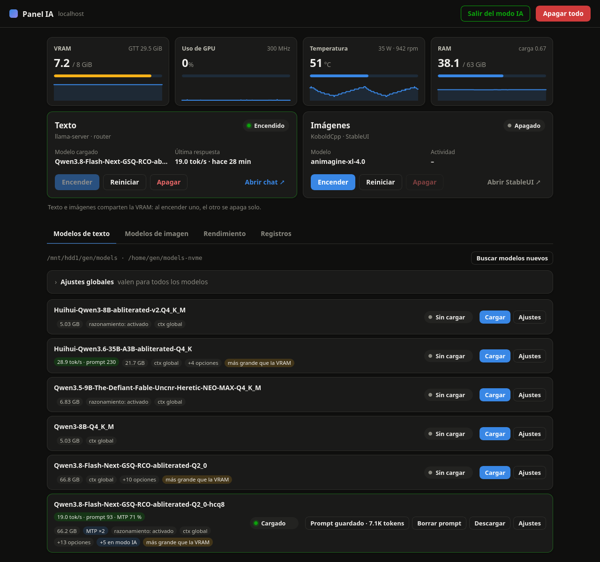
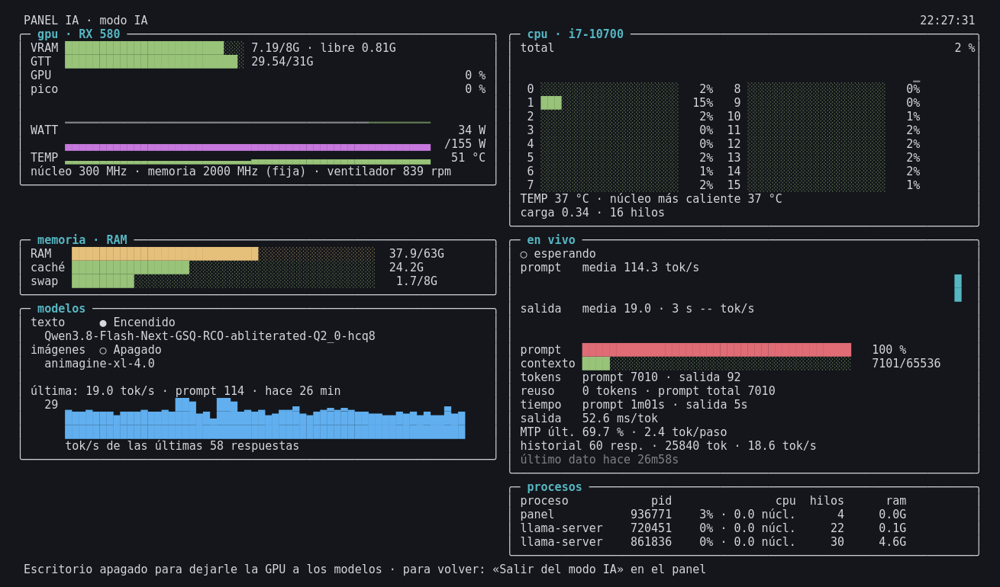

# llama-panel

Panel web casero para levantar y bajar modelos on demand en una GPU con poca VRAM (Vulkan):

- **Texto:** `llama-server` (llama.cpp) en modo router, puerto 8080.
- **Imágenes:** KoboldCpp con StableUI, puerto 5001.
- **Panel:** puerto 8090. Texto e imágenes se excluyen mutuamente para compartir la VRAM.

Solo usa la biblioteca estándar de Python 3, sin dependencias ni paso de build.



Está hecho y medido para una máquina concreta (AMD RX 580 de 8 GB solo con Vulkan, 64 GB de RAM, Linux con systemd).
La bitácora de rendimiento ([docs/analisis-rendimiento.md](docs/analisis-rendimiento.md)) y las notas de hardware
([docs/notas.md](docs/notas.md)) explican cada configuración con números; pueden servir en otras GPU con poca VRAM.

> **Seguridad:** el panel (8090), llama-server (8080) y KoboldCpp (5001) escuchan en todas las interfaces y **no
> tienen autenticación**: cualquiera que llegue a esos puertos puede cargar, bajar y configurar modelos. Pensado
> solo para una red local de confianza. No los expongas a internet; si hace falta acceso remoto, usá una VPN o un
> túnel SSH, o limitá los puertos con el firewall.

## Qué hace

- Monitor de VRAM, uso de GPU, temperatura/consumo/ventilador y RAM, con historia de los últimos minutos.
- Encender, reiniciar y apagar texto e imágenes; al encender uno, el otro se apaga para liberar VRAM.
- Cargar y descargar un modelo de texto puntual (API del router de llama-server) sin reiniciar nada.
- Ajustes por modelo (MTP, razonamiento, contexto, opciones extra); "Guardar y aplicar" recarga solo lo necesario.
- Prompt inicial guardado: con un cliente tipo agente (Cline, etc.), "Guardar prompt" escribe a disco el prompt fijo
  ya procesado y el panel lo restaura solo cada vez que el modelo se carga (un minuto de espera menos por sesión).
- Elegir el modelo de imagen y sus flags de KoboldCpp, con progreso de la generación en curso.
- Rendimiento: tokens/s por respuesta (prompt y generación, aceptación MTP) y duración de cada imagen.
- Registros en vivo de cada servicio, con filtro.

## Estructura

```
panel.py              punto de entrada: corre el servidor o --install
llama_panel/
  config.py           rutas, puertos, settings.json
  text_models.py      escaneo de .gguf, presets.ini del router, validación
  prompt_cache.py     prompt inicial guardado: estado del slot a disco y restauración al cargar
  img_models.py       escaneo de imagen, acompañantes (VAE/codificadores), kobold.env
  services.py         systemctl y clientes HTTP del router y de KoboldCpp
  hardware.py         sensores de GPU/RAM y muestreo en segundo plano
  stats.py            parseo de journalctl: tokens/s, imágenes, registros
  actions.py          lo que hacen los botones (cargar, guardar, aplicar, encender)
  api.py              rutas /api/*
  server.py           servidor HTTP
  install.py          units de systemd
static/
  index.html, app.css
  js/                 módulos ES nativos, sin build (main.js arranca todo)
tests/                unittest de la stdlib
scripts/
  update-llama.sh     actualiza llama.cpp manteniendo los parches (--check solo informa)
  install-gpu-mclk.sh opcional, con sudo: reloj de la VRAM al máximo mientras corre un modelo
  install-modo-ia.sh  opcional, con sudo: "modo IA" (apaga el escritorio, dashboard en tty1)
patches/              parches locales de llama.cpp y cómo reaplicarlos
tools/bench/          benchmark, uso de CPU/GPU, tamaños de GGUF y test de humo de los modelos
tools/                utilidades de GGUF (hc en Q8_0, borrador MTP con salida recortada)
docs/notas.md         hardware, mediciones, por qué cada configuración, trampas conocidas
.claude/skills/       skill llama-cpp-update (revisar novedades y actualizar llama.cpp)
```

## Requisitos

- Linux con systemd (servicios de usuario) y Python 3.
- `llama-server` compilado con Vulkan; por defecto se busca en `~/llama.cpp/build/bin/llama-server`.
  Para usar las configuraciones de los modelos MoE grandes hace falta el fork (ver abajo).
- Opcional, para imágenes: [KoboldCpp](https://github.com/LostRuins/koboldcpp) (por defecto `~/koboldcpp/koboldcpp`).
- Modelos `.gguf` en `~/models` y de imagen en `~/imgmodels`, o donde digan las rutas configuradas.

## Instalación

```bash
python3 panel.py --install
```

Crea los servicios systemd de usuario (`llama-panel`, `llama-router`, `kobold-img`) y arranca el panel.
La configuración del usuario vive en `~/.config/llama-panel/` (fuera del repo).

Las rutas se cambian con variables de entorno o, más cómodo, en `~/.config/llama-panel/paths.env`
(una variable de entorno con el mismo nombre tiene prioridad):

```ini
LLAMA_MODELS_DIR=/mnt/datos/models
LLAMA_EXTRA_MODELS_DIRS=~/models-nvme
LLAMA_IMG_DIR=/mnt/datos/imgmodels
KOBOLD_BIN=~/koboldcpp/koboldcpp
LLAMA_SERVER_BIN=~/llama.cpp/build/bin/llama-server
```

Después de cambiar `KOBOLD_BIN` o `LLAMA_SERVER_BIN` hay que volver a correr `--install` (quedan escritos en los units).

Los scripts de `scripts/install-*.sh` son opcionales, se corren una vez con `sudo` y tienen `--uninstall`.
Cada uno instala un ayudante en `/usr/local/sbin` y una regla en `/etc/sudoers.d` que deja correr **solo** ese
ayudante sin contraseña. El modo IA **cierra la sesión gráfica** al activarse; leé el encabezado de cada script antes.

En modo IA el escritorio se apaga para liberar la VRAM que ocupaba, y tty1 muestra este dashboard de texto
(`llama_panel/kiosk.py`; para verlo por SSH sin activar nada: `python3 -m llama_panel.kiosk --once`):



## llama.cpp: por qué un fork

El servidor de texto usa el fork [PrivacyPolicy404/llama.cpp](https://github.com/PrivacyPolicy404/llama.cpp)
(rama `ot-host-buffers`): el llama.cpp oficial más parches locales.
El principal existe por los modelos MoE grandes que no entran en la VRAM, como Qwen3.8-Flash-Next (125B):

- Sus expertos viven en la RAM. Si están en memoria *fija* (pinned), la GPU los copia más rápido y el prompt se procesa ~20 % más rápido.
- En amdgpu la memoria fija tiene un tope (GTT) de la mitad de la RAM: 31 GiB en esta máquina. Los expertos de Flash-Next ocupan 31.6 GiB:
  fijarlos todos tira el driver ("device lost").
- llama.cpp oficial solo permite fijar todo o nada. El parche deja elegir qué capas fijar con `-ot ...=Vulkan_Host`:
  así entran 44 de 48 capas en el tope.

Sin el parche ese modelo no carga con la configuración del panel; el resto de los modelos no lo necesita.
Detalles, números y cómo reaplicarlo: [patches/README.md](patches/README.md).

Para actualizar llama.cpp sin perder los parches: `scripts/update-llama.sh` (con `--check` solo informa cuántos commits nuevos hay).
La versión queda fija hasta que se corre el script.

## Desarrollo

El servicio corre el código directamente desde esta carpeta y `llama-panel-reload.path` reinicia el panel cada vez
que se guarda `panel.py` o algo en `llama_panel/`. Los archivos de `static/` se leen en cada pedido, así que alcanza
con recargar el navegador.

Solo hace falta volver a correr `--install` si cambian los units de systemd (`llama_panel/install.py`).

```bash
python3 -m unittest            # tests
journalctl --user -u llama-panel -f   # ver errores del panel
```

Para validar la ventana de 64K por el router, con 62.000 tokens de entrada y 2.048 de salida,
`tools/bench/ctx_stability.py` registra memoria VRAM/GTT por proceso y verifica tres cargas con generación.
Requiere servidores y modo IA apagados. **Cierra la sesión gráfica** durante la prueba y restaura el
escritorio y los límites de memoria al terminar:

```bash
python3 tools/bench/ctx_stability.py --ai-mode --output ~/llama-panel-results/64k-corrida-1
```

La carpeta de salida debe ser nueva. Conserva respuestas, tokens de entrada, muestras con fecha y fase,
presets, versiones y registros del router/kernel. Puede tardar más de 15 minutos. La generación forzada
evalúa estabilidad, no calidad semántica; las velocidades dependen del texto y del contexto ocupado.

Para comprobar recuperación de información y conversación con ~58K tokens del propio proyecto:

```bash
python3 tools/bench/ctx_quality.py --ai-mode --output ~/llama-panel-results/64k-calidad-1
```

Guarda las respuestas esperadas antes de inferir, comprueba marcas nuevas distribuidas en el contexto,
datos del código, varios turnos, reutilización del prompt y una conversación cercana al límite. También
registra la respuesta del servidor a una entrada que excede la ventana. Requiere servidores apagados;
conserva el estado inicial del modo IA y los ajustes. Es una evaluación puntual, sin control F16 ni comparación
entre modelos.

Para comparar uno y dos slots, con dos trabajos en serie/concurrentes y, opcionalmente, continuaciones con caché:

```bash
python3 tools/bench/parallel_test.py --output ~/llama-panel-results/parallel-1
python3 tools/bench/parallel_test.py --followup --output ~/llama-panel-results/parallel-conversacion-1
```

Requiere modo IA activo, Flash-Next cargado e inactivo. Descarga el modelo del panel (pierde la caché), usa un
router aislado y restaura la carga inicial. No cambia ajustes. Con 64K totales, dos slots tienen 32K cada uno.
Mide 256 tokens forzados por trabajo; no evalúa la calidad de un subagente ni los tiempos de sus herramientas.

Los modelos de texto se buscan en `LLAMA_MODELS_DIR` y en las carpetas de `LLAMA_EXTRA_MODELS_DIRS` (separadas por `:`, por defecto `~/models-nvme`). Los modelos partidos en shards (`-00001-of-0000N.gguf`) cuentan como uno solo.

Variables de entorno opcionales: `LLAMA_MODELS_DIR`, `LLAMA_EXTRA_MODELS_DIRS`, `LLAMA_IMG_DIR`, `LLAMA_SERVER_BIN`, `KOBOLD_BIN`, `LLAMA_PANEL_PORT`, `LLAMA_PANEL_DIR`.

## Licencia

[MIT](LICENSE). llama.cpp y KoboldCpp tienen sus propias licencias.
